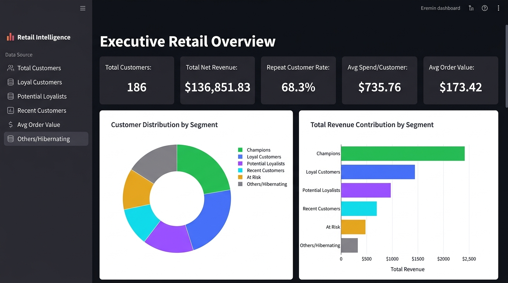
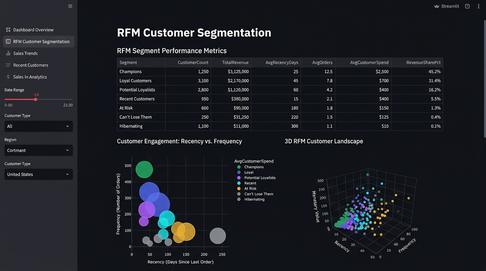
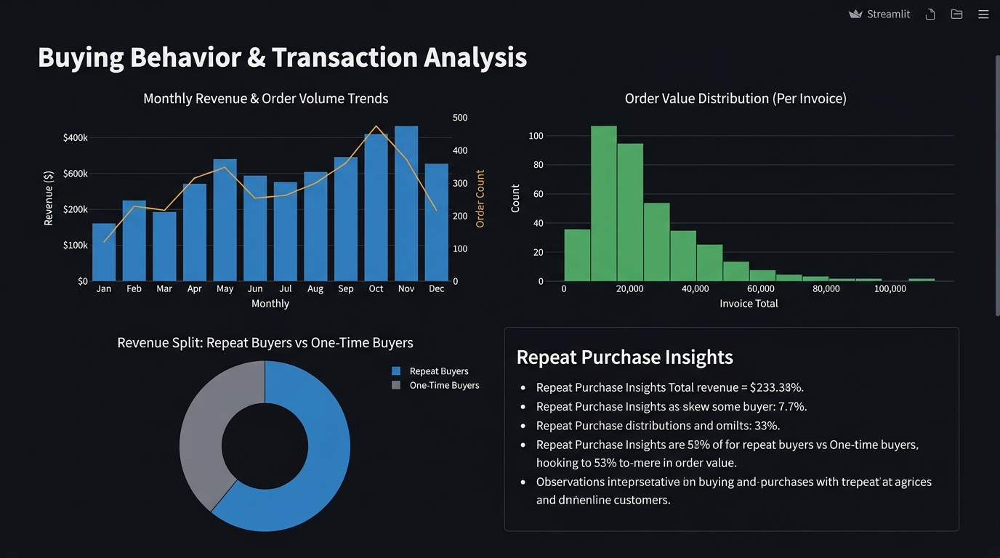
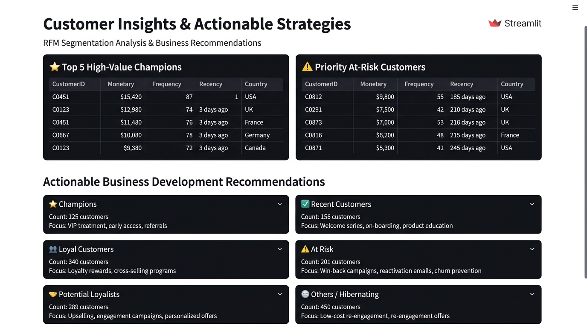

# Customer Segmentation & Buying Behavior Analysis

A customer analytics platform that helps retail businesses understand purchasing patterns, identify high-value customer groups, measure repeat retention, and drive data-driven marketing decisions.

Built with **Python · Pandas · SQLite · Streamlit · Plotly · Scikit-learn**

---

## 📌 Business Objective

Customer acquisition costs keep rising — maximizing Customer Lifetime Value and reducing churn is critical. This application:

- Ingests raw transactional data and applies transparent data quality governance
- Computes customer-level **RFM (Recency, Frequency, Monetary)** metrics
- Segments customers into actionable business categories
- Provides rule-based marketing recommendations per segment
- Offers an embedded SQL analytics engine for ad-hoc exploration

---

## 📸 Dashboard Screenshots

### Executive Overview
KPIs at a glance — total customers, revenue, repeat rate, average spend, and segment distribution.



### Customer Segmentation
RFM segment breakdown table, interactive 2D bubble chart, 3D RFM landscape, and exploratory K-Means clustering.



### Buying Behavior
Monthly revenue trends, order value distribution, and repeat vs. one-time buyer revenue split.



### Customer Insights & Actions
Top Champions, priority At-Risk accounts, and segment-specific business development recommendations.



### Data & SQL Explorer
Data cleaning audit trail, cleaned transaction preview, and interactive parameterized SQL query runner against SQLite.

> Run `streamlit run app.py` locally to explore this tab with live SQL queries.

---

## 🛠️ Tech Stack

| Layer | Tools |
|:------|:------|
| Data Processing | Python, Pandas, NumPy |
| Database & SQL | SQLite3 (parameterized queries) |
| Dashboard | Streamlit |
| Visualizations | Plotly |
| Machine Learning | Scikit-learn (K-Means, StandardScaler, Silhouette) |
| Testing | Pytest |
| Version Control | Git & GitHub |

---

## 📂 Project Structure

```
├── app.py                         # Streamlit multi-tab dashboard
├── requirements.txt               # Dependencies
├── data/
│   ├── README.md                  # Dataset source & legal info
│   └── sample_retail_data.csv     # Synthetic demo dataset (3,500 rows)
├── src/
│   ├── generate_sample_data.py    # Synthetic data generator
│   ├── data_cleaning.py           # Preprocessing & audit tracking
│   ├── rfm_metrics.py             # RFM calculation engine
│   ├── segmentation.py            # Rule-based segments & K-Means
│   ├── db_manager.py              # SQLite & SQL queries
│   └── charts.py                  # Plotly chart builders
├── tests/
│   └── test_analytics.py          # 5 passing pytest tests
├── screenshots/                   # Dashboard previews
└── .gitignore
```

---

## 📊 Methodology

### Data Cleaning
| Rule | Action |
|:-----|:-------|
| Missing CustomerID | Excluded from RFM (guest checkouts logged) |
| Cancelled invoices | Filtered (`InvoiceNo` starting with 'C' or negative qty) |
| Zero/negative prices | Removed |
| Duplicate rows | Deduplicated |
| Revenue | Calculated as `Quantity × UnitPrice` |

### RFM Metrics
- **Reference Date** = `max(InvoiceDate) + 1 day` — simulates running the analysis "the next morning"
- **Recency** = Days since customer's last purchase
- **Frequency** = Count of distinct invoices
- **Monetary** = Total lifetime spend

### Customer Segments

| Segment | Who They Are | Recommended Action |
|:--------|:-------------|:-------------------|
| **Champions** | Recent, frequent, high spend | VIP rewards, advocacy programs |
| **Loyal Customers** | Consistent repeat buyers | Cross-sell, loyalty milestones |
| **Potential Loyalists** | Recent with above-avg activity | 2nd-purchase incentives, onboarding |
| **Recent Customers** | New single-purchase buyers | Welcome sequence, trust building |
| **At Risk** | Formerly active, now inactive | Win-back campaigns, feedback surveys |
| **Others / Hibernating** | Low across all metrics | Low-cost seasonal campaigns |

> All recommendations are framed as **suggested actions to test**, not guaranteed outcomes.

---

## 📈 Sample Findings (from Included Synthetic Dataset)

| Metric | Value |
|:-------|:------|
| Raw Transactions | 3,500 |
| Cleaned & Retained | 2,971 (84.89%) |
| Guest Checkouts Excluded | 396 |
| Unique Customers | 186 |
| Repeat Customer Rate | 68.28% |
| Avg Lifetime Spend | $735.76 |
| Champions Revenue Share | $94,402 (69.0%) |
| At-Risk Revenue at Stake | $4,708 |

---

## 🚀 Setup Instructions (Windows / PowerShell)

```powershell
# 1. Clone
git clone https://github.com/Jeelanimohammad/customer-segmentation-buying-behavior-analysis.git
cd customer-segmentation-buying-behavior-analysis

# 2. Virtual environment
python -m venv venv
.\venv\Scripts\Activate.ps1

# 3. Install dependencies
pip install -r requirements.txt

# 4. (Optional) Regenerate sample data
python src/generate_sample_data.py

# 5. Run tests
python -m pytest tests/ -v

# 6. Launch dashboard
streamlit run app.py
```

Open `http://localhost:8501` in your browser.

---

## 📦 Dataset

**Primary**: [UCI Online Retail Dataset](https://archive.ics.uci.edu/dataset/352/online+retail) — download and save as `data/online_retail.csv`, or upload directly via the dashboard.

**Included**: A synthetic demo dataset (`data/sample_retail_data.csv`) generated with `src/generate_sample_data.py`. This is **not real commercial data** — it replicates the UCI schema for reproducible demonstrations.

---

## ✅ Tests

All 5 tests pass:

```
tests/test_analytics.py::test_data_cleaning_filters_and_revenue    PASSED
tests/test_analytics.py::test_clean_retail_data_empty               PASSED
tests/test_analytics.py::test_rfm_calculation                       PASSED
tests/test_analytics.py::test_segmentation_assignment               PASSED
tests/test_analytics.py::test_sqlite_database_and_parameterized_query PASSED
```

Covers: data cleaning rules, revenue calculation, RFM computation, segment assignment, SQLite parameterized queries, and empty-data edge cases.